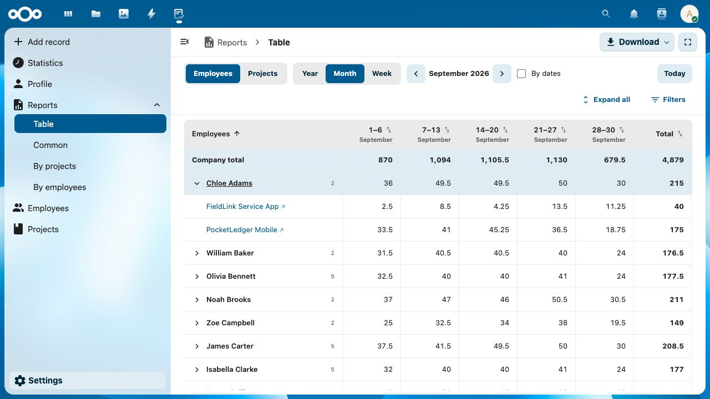
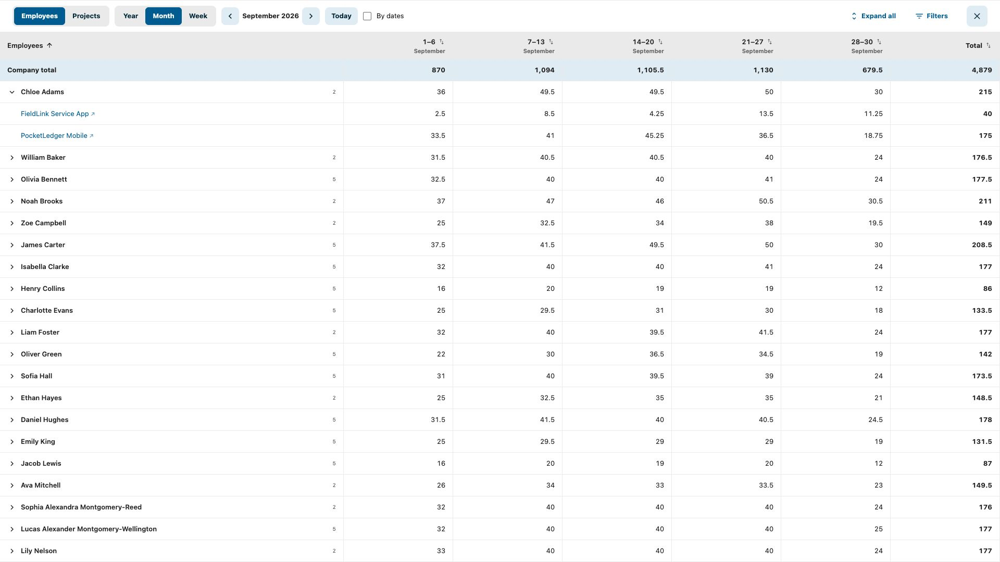

# Table report

The report lives at `/apps/done/reports/table` and appears under Reports as
**Table** (localized in each supported language). It defaults to Employees and the current month. Query
parameters (`date`, `period`, `mode`, `by_dates`, `sort`, `direction`, `project_ids`, `user_ids`) preserve the view in links.

## Screenshots

Screenshots use fictional demo data.





## Behaviour

- Employees expand into projects; projects expand into employees. The company
  row and parent totals include their children, so expanded rows are never added
  to totals again.
- Names in expanded child rows link to the project's card or employee's profile.
  Drawer entity names and its selected-entity heading link to the same preview
  pages. Employee detail entries show the project as the main heading and the
  employee beneath it; project detail entries show employees first. Missing
  entity records retain plain text without a broken profile link.
- Year columns are calendar months. Month columns are Monday–Sunday weeks,
  clipped to the first and last day of that month. **By dates** shows individual
  days. Week columns run Monday through Sunday, including across year boundaries.
  Month-view week headers put day ranges above the full month name. Week-view
  day headers show full weekday names on the second line, with compact spacing.
  Calendar labels follow the user's language; report interface strings are
  available in English, German, Spanish, French and Russian.
- Arrows go to the nearest preceding/following period containing time entries.
  They are disabled when no such data exists. Empty periods retain navigation.
- Clicking the hours in a cell or a row total opens its time entries in the right drawer.
  Entries are loaded in pages of 100, automatically as the detail list scrolls near
  the bottom; a manual load button also shows the loaded/total count. Descriptions,
  multiline comments and optional HTTP(S) task links appear in each entry. Zero cells and zero totals show a plain dash
  without a detail link.
- The entire name cell activates its expand button, profile link or header sort.
  Hour cells remain clickable only on the number. When the table overflows, empty
  cell space shows a grab cursor and supports horizontal mouse dragging; touch
  devices retain native scrolling. The pinned name and total columns stay fixed.
  Their inner edges cast a shadow only while columns are hidden on that side;
  each shadow disappears at the corresponding horizontal scroll boundary.
- The shared VToolbar holds Reports / Table breadcrumbs and the standard secondary
  Download menu with a leading download icon, plus a fullscreen button. A compact
  controls bar contains grouping, calendar, Today, By dates, Expand/Collapse all
  and Filters. Controls wrap at narrower widths; there is no explanatory footer.
- Fullscreen hides Nextcloud navigation and the report toolbar while retaining
  display controls, filters and details. Escape or the close button exits.
  Browsers without native fullscreen use a viewport-filling fallback. Filters,
  sorting and expanded rows survive the transition.
- At widths up to 600px, the name column stays pinned and the period total moves
  beneath the name, leaving space for horizontally scrolling date columns.
  Drawers use the available screen width. This is an initial mobile interface;
  browser viewport checks do not replace testing on physical devices.
- Header buttons sort employees by surname, then given name (including expanded
  employees under projects), projects by title, or any time column/period total
  numerically. Repeated clicks reverse the direction. The initial order is name
  ascending; a newly chosen numeric column starts descending. The server sorts
  parents and children within each parent, with alphabetical ties and an unchanged
  company total at the top. Exports preserve this order. Changing the calendar
  resets a date-column sort to name ascending; sorting by the period total persists.
- Rows include entities with entries in the selected period. Deleted time
  entries (`status_id = 5`) are excluded. Missing user/project records retain
  their historical time under an “Unknown” label.
- All aggregation uses integer minutes; the interface displays decimal hours
  rounded to two places. This is allocated time, without a capacity comparison.

## Access and implementation

The Filters action beside Expand all opens a right-hand panel. Searchable lists
of existing, non-deleted projects and employees are independent of the date range.
Selections apply immediately and intersect: totals contain only entries matching
both lists. Both groups are visible together as chips, initially All projects and
All employees. The initial All chip opens the searchable, scrolling selection
list. Once restricted, a circular plus button leads the chips and opens that list.
The list closes on its close button or the first click outside it. That first
click is consumed, even outside the drawer, so the drawer stays open and no table
action is triggered. Once the list is closed, a click outside the drawer closes
the whole drawer (filters or time details),
without stealing focus from the clicked control. Clicking an hour or the Filters
action switches drawer content directly without a close/open animation. Click an unselected name to add a chip; selected names
are omitted from the list and return when their chip is removed. The first
selection replaces All; subsequent selections add chips. Removing the last chip
restores All, as does the group's Clear action beside its heading. Each chip group
scrolls independently while its heading and clear action remain visible.
Filters and time details share one drawer, so switching between them replaces
content without overlapping slide animations.
Explicit empty URL/API selections still
match nothing and are displayed as None selected.
Filters persist in the URL (`project_ids`, `user_ids`, comma-separated IDs), and
apply to parent/child rows, totals, period navigation, details and all exports.
Closing the panel or switching grouping/period preserves the selection.

The report requires the Reports module, the Officer role, and both
`canReadCommonReport` and `canReadStaffReport`. The server checks permissions
independently for the table, details and exports. The client route and navigation
use the same report permissions.

`ReportsMatrixPage.vue` uses `src/entities/reports/api.js` to call the existing reports module dispatcher with
`getMatrix`, `getMatrixEntries`, `getMatrixFilters`, and `exportMatrix`. `MatrixReportService` reads
the existing time/user/project tables without a schema change.
`MatrixReportBuilder` owns calendar boundaries and aggregation independently of
Nextcloud. Requests validate dates, periods, entity IDs and detail ranges;
superseded frontend requests are cancelled.

## Exports

All formats recompute authorized data on the server and export the company row,
parent rows and only the expanded child rows. Screen scrolling does not limit
exported rows or columns.

- **Excel** uses PhpSpreadsheet with numeric hour values, a frozen name/header
  area and outlined child rows. Names are explicitly stored as text to prevent
  formula interpretation.
- **HTML** is a standalone UTF-8 document with inline styles and escaped text.
- **PDF** uses Dompdf with Unicode fonts and remote resources, PHP and JavaScript
  disabled. Wide tables split into groups of at most ten date columns; names and
  full-period totals repeat, and headers repeat on vertical page breaks.

Exports accept at most 5,000 visible rows; PDFs additionally accept at most
20,000 cells. The module API uses base64 in the existing JSON transport; the
browser downloads an HTTP attachment through `/reports/table/export`, which
delegates to the same module dispatcher and permission checks.
Dompdf is a new production dependency: install from `composer.lock` and include
its dependencies/fonts when packaging a release. Frontend assets must be rebuilt.

## Known limitations and release review

- Export headings, month labels and explanatory text are currently English,
  regardless of the interface language. Entity names retain Unicode.
- Name sorting uses PHP natural, case-insensitive string comparison, with surname
  first for employees; it is not a locale-aware collation implementation.
- This report shows recorded time, not contractual capacity or overtime balances.
- No database migrations are introduced. Review the Officer role and combined
  report permissions against the intended access policy before release.
- Review large installations separately: daily totals and the result hierarchy
  are materialized on the server, and all visible table rows render on the client.
- The repository App Store workflow includes production Composer dependencies.
  The local `make appstore` / `make test-release` targets exclude `vendor`; do not
  ship their archive without ensuring the required dependencies are included.

## Validation

Standalone regression checks, from the repository root with PHP dependencies
installed:

```sh
php tests/matrix-report.php
php tests/matrix-export.php
php tests/matrix-filters.php
npx eslint src/pages/ReportsMatrixPage.vue
npm run build
```

Calendar tests cover leap years, clipped weeks, year boundaries, invalid dates,
exact-minute aggregation and expanded-row selection. Export tests check numeric
Excel totals, literal formula-like names, HTML escaping, Unicode and PDF output.

On the local Docker demo, API results were compared with the original daily
ledger for September 2026: 30 employees, 10 projects and 4,879 hours in both
groupings. Checks also covered pagination totals, empty periods, range boundaries,
invalid requests and denial of all four module endpoints for an ordinary employee.
Month and daily-column PDFs were rendered and inspected; the latter spans six
pages without losing columns. Browser checks cover both hierarchies, all three
periods, daily columns, the detail drawer and downloading an export.

### Manual review checklist

1. Open Reports → Table as an Officer with both report permissions. Compare a
   known month's total against the existing report.
2. Switch Employees/Projects; expand a row and follow its child profile link.
   Change Year/Month/Week, By dates, navigation and name/total/date sorting.
3. Add projects and employees in Filters. Check intersecting totals, removal of
   chips, clear selection, and first/second outside-click behavior.
4. Open a nonzero cell and check descriptions, multiline comments, optional task
   links, single-day labels and loading beyond 100 entries. Zero cells do not open.
5. Export the filtered view with expanded rows in each format; compare totals
   and order. Check daily-column PDF panels for all dates.
6. Enter fullscreen, change grouping/period/sorting, then exit using the close
   button and Escape. Verify controls and text selection remain stable.
7. At phone widths, check long names, horizontal date scrolling, totals under
   names and full-width drawers. Repeat on actual supported mobile devices.
8. Verify a user without the required permissions cannot access the report,
   filter catalogs, entry details or the direct download endpoint.

## Comparison with existing Done tables

| Area | Existing implementation | Time allocation table |
| --- | --- | --- |
| Server module | `ReportsController` / `ReportsService` aggregate the Common and By employees reports | Same Reports module and access checks; dedicated `MatrixReportService`, `MatrixReportBuilder`, `MatrixReportExport` |
| Calculations | `ReportsService` sums integer minutes and formats totals; `timeTrackingPageMixin` calculates the requested date range in the browser | Server calculates calendar boundaries, columns, groups and totals. Browser formats minutes as hours and dates for display, manages expanded rows and loads details |
| API | Report pages call `src/entities/reports/api.js` | Uses the same API layer, including the download URL builder |
| General tables | Projects and Employees pages compose `VPage`, `DynamicTable`, `VTable`, Pinia table settings and `ExportButton` | Dedicated semantic table for the two-level time matrix; it does not inherit DynamicTable's editing, filtering, ordering or saved column settings |
| UI controls | `NcActions` / `NcActionButton` and Material Design SVG icons | Uses these same controls for the two-click download menu and SVG chevrons; period/group selectors share one segmented-button style |
| Styling | Shared `VTable.css`, Nextcloud theme variables, toolbar/breadcrumb layout; sticky cell styles at desktop widths | Scoped matrix styles with the same theme variables, shared breadcrumbs and compact controls; names and totals stick at both edges on desktop; mobile totals move below names |
| Localization | `contextTranslate` supports contextual dictionaries and falls back to Nextcloud `t('done', key)` | UI uses Nextcloud `t('done', key)` directly, with translations in all five supported language dictionaries; dates/numbers use the browser's document language |

This is integrated into the existing Reports module, but it is not a complete
reuse of the generic table widget. The specialized hierarchy and calendar columns
justify a separate matrix renderer. If another page needs it, extract the matrix
and detail drawer into reusable widgets instead of duplicating this page.

Interface strings have translations in all five supported languages. Export
headings/month labels and missing-entity fallback names remain English.
Context-specific terminology overrides are not connected to this page. Fully
localized exports would require passing the user's locale/translator into the
export renderer; this does not affect numerical calculations.


## Long text validation

Parent project/employee names and child profile links wrap within the pinned name
column. Detail headings also wrap; the external-link arrow is kept with the last
word. Entry comments preserve newlines and wrap long URLs. Validated against the
local enriched fixture with two long project names, two long employee names and
short/multiline/long comments. The initial phone layout below replaces the previous
two-pinned-column layout, which left only ~47px for dates at 360–390px.

### Compact controls and initial phone interface

The display controls and expand/filter actions share one toolbar; the explanatory legend is removed.
Above 1180 px of available report width, Today follows the period selector, then By dates;
the actions stay on the same row. At intermediate widths, By dates moves next to the
period selector, Today aligns right, and the actions wrap to a second row. Below 900 px,
Today shares the actions row on its left, while expand/filter actions remain right-aligned.

Display options are always visible; there is no hide-options button. At viewport widths up to 600 px,
grouping and scale share a row, followed by period/By dates and then Today/expand/filter actions. The export button becomes an accessible icon button. The name column
is 148 px wide with wrapping names; the period total is shown below each name and opens the same details
as the desktop total. A separate total sorting button remains available in the name-column header.
Date columns scroll horizontally using native touch scrolling. The desktop sticky total column is hidden
on phones. Filters and time details fill the report width, with larger controls and comment text.
Fullscreen retains the display controls and adds an exit button at the far right; Escape also exits.
Resizing preserves period, filters, sorting and expanded rows. Export includes the normal total column.

Browser viewport checks: 360, 390, 768, 1017 and 1600 px. Verified responsive controls, long-name wrapping,
filter selection, total sorting, year/week/month controls, detail comments, the export menu, and
mobile fullscreen entry/exit with restoration of the Nextcloud header. These are browser viewport
checks, not physical-device or virtual-keyboard tests.

Time details load the next page when the user scrolls within 240 px of the end. The manual load button
remains, showing loaded / total counts and a disabled loading state. Requests are serialized; errors
stop automatic retries until the user retries explicitly. Opening another cell resets list scrolling.

Validated infinite scrolling on the August 2026 Atlas Analytics Workspace detail list:
100 → 200 → 300 → 400 → 473 rendered entries, then the load-more button disappears.
Also checked black/underlined hover on expand buttons, shared Today/actions row at 768 px,
By dates beside the period selector and Today at the right at intermediate widths,
and fullscreen controls plus button/Escape exit.
